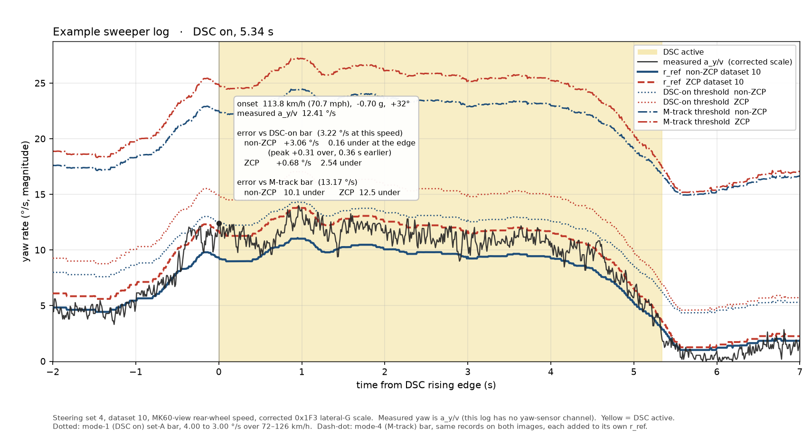

# E46 M3 dataset 10 versus the ZCP calibration

Hand-written note (2026-11-20). Companion to `e46_m3_non_zcp_mk60_image.md`, `zcp_mk60_image.md`, `e46_steering_ratio_tables.md` and `e46_m3_mk60_image_check_word.md`. Addresses are 818.3 unless a ZCP twin is named.

Dataset 10 (`k_ds` from packed coding byte 1, bits 4:0, at `0x40100F` on 818.3) is the E46 M3 slot, and it is the column in use on the example C06 car (`BAUART_MK60 = csl`). This note records the 818.3 versus 817.3 ZCP values in that slot, what A, B, T0, T3 and T4 actually do, a structure-aligned inventory of the rest of the two calibration tails, and the mode-1 / mode-4 oversteer bars. It is a comparison of the two images, not a procedure for writing either one.

Confidence: **[C]** read from the image, from algebra that the listing forces, or from the E46 C06 daten and an NCS trace, **[I]** inferred, **[open]** not established.

## Dataset 10 values

The fourteen signed 16-bit columns live in program flash, not EEPROM. Bases and the dataset-10 cells:

| Column | 818.3 base | 818.3 ds10 | 817.3 ZCP base | ZCP ds10 |
|---|---|---|---|---|
| T0 | `0x3E874` | **38** at `0x3E888` | `0x3EEC8` | **37** at `0x3EEDC` |
| A  | `0x3E890` | **1846** at `0x3E8A4` | `0x3EEE4` | **1845** at `0x3EEF8` |
| B  | `0x3E8AC` | **1565** at `0x3E8C0` | `0x3EF00` | **2400** at `0x3EF14` |
| T3 | `0x3E8C8` | **1846** at `0x3E8DC` | `0x3EF1C` | **1845** at `0x3EF30` |
| T4 | `0x3E8E4` | **131** at `0x3E8F8` | `0x3EF38` | **201** at `0x3EF4C` |

`v_ch` is not a stored word. It is formed at run time from A and B:

| Image | `v_ch = √(32·A·B) / 100` |
|---|---|
| 818.3 | 96.15 km/h |
| ZCP | 119.04 km/h |

T0–T4 in every other dataset slot are **byte-identical** between the two M3 images. The only T-column difference is dataset 10. [C]

## Live dataset index

Packed coding record `0xA3` byte 1, bits 4:0, is stored at packed base+1 (`0x40100F` on 818.3) and is the dataset index `k_ds` used to pick the flash T0 / A / B / T3 / T4 column. The unpacker is at `0x3B5D8`. [C]

The keyword that fills that field is **`BAUART`** (FSW id `0x0425`), reported in NCS traces as **`BAUART_MK60`**. In the E46 `MK60.C06` daten it sits at byte 1, mask `0x1F` — exactly `k_ds`. [C] The other byte-1 field in that file, `UNTERSTEUERSCHWELLE_2` (mask `0x80`), does not overlap bits 4:0. Steering-set coding (`LENKWINKELKENNLINIE`) is a different record (byte 13) and is not `k_ds`. [C]

C06 lists three `BAUART` werts:

| Data byte | C06 PSW name | Name in the example NCS traces |
|---|---|---|
| **10 (`0x0A`)** | `coupe_s` | **`csl`** |
| 11 (`0x0B`) | `coupe` | |
| 12 (`0x0C`) | `cabrio` | |

The example car’s C06 traces read **`BAUART_MK60 = csl`**, so they run **dataset 10**. [C] for the keyword, the mask, the live wert, and the C06 data-10 slot; **[I]** only that the pack name `coupe_s` and the trace name `csl` are the same slot. The official C06 file in the daten pack used for the mapping never uses the string `csl`; the traces report that first sport-coupe slot as `csl`. Either way the packed value is 10. A live read of record `0xA3` byte 1 / `0x40100F` (or an MK60 `NETTODAT`) would show the packed byte directly, but it is not required in order to treat dataset 10 as the column in use.

Coding selects only the *index*. An 818.3 flash still has the short dataset-10 column (`B = 1565`, `v_ch` = 96.15 km/h). `BAUART_MK60 = csl` cannot install the ZCP `B = 2400`. [C]

## `r_ref`: A is L, `v_ch² = 32·A·B`

The closed form at `0x29606` (ZCP twin `0x29B2E`) is:

```
r_ref = δ · v  /  ( A · (1 + v² / v_ch²) )
      = δ · v  /  ( A + v² / (32·B) )
```

with `v_ch² = 32·A·B`. A is the wheelbase length L in this formula, not merely a factor inside the product `A·B`. [C]

A and B are read from flash on every evaluation (`ld.h`); there is no RAM copy of the tables. The only 818.3 readers of the A and B bases are this routine and its sibling at `0x29898`. [C]

The sibling builds the same denominator `F = A + v²/(32·B)` (A again used alone as L; it does not form a separate `A·B` product). Above 10 km/h it scales four signals, including the yaw residual at `0x400922`. [C]

Because A enters as L, a change to B alone moves `v_ch` and the high-speed term; a change to A also scales the whole denominator, including at low speed.

## T0, T3, T4

**T0** is a wheel-speed yaw scale in the E9x AF4 family. It is not an input to `r_ref`. Dataset 10 differs by one count (38 versus 37). [C] for the column and the one-count difference; **[I]** for the physical reading, from the E9x analogue and the table layout.

**T3** is a near-copy of A (identical in every slot of both M3 images, including dataset 10). It is the length term in the estimated yaw `r_est` below. [C]

**T4** is the understeer divisor in that same estimate. Across the 28 slots of the two M3 images it tracks

```
T4  ≈  1.8 · v_ch² / g  =  32·A·B / 706320
```

to within one count in 26 of 28 slots. Dataset 3 is the shared exception (stored 116 versus a prediction of 165) on **both** images, so it is a deliberate common cal, not a ZCP-only change. On dataset 10 the ZCP value 201 is exactly the formula for A=1845, B=2400; 818.3’s 131 is the same formula for 1846/1565 (predicted 130.7, stored 131). [C] for the fit and the two dataset-10 cells; **[I]** that the 1.8 / *g* reading is the intended physical scale.

T3 and T4 have a single reader: `0x26258` (ZCP twin `0x26780`). No other `lrw` or table-of-tables pointer to those bases was found. [C]

## `r_est` at `0x26258`

The routine forms

```
r_est  =  v · δ_filt / T3  −  v · a_y / T4
```

Inputs on 818.3:

| Symbol | Address | Scale |
|---|---|---|
| `δ_filt` | `0x400A4E` | filtered steer (same path as `r_ref`) |
| `a_y` | `0x400968` | lateral acceleration, 0.01 g per bit |
| `v` | `0x401038` | vehicle speed |

If `|r_est| − |r_ref|` exceeds **698** (2.0 °/s at the 349 counts/° yaw scale used in the mode-1 bars), a debounce sets **bit 7 of `0x400AC3`**. That is a plausibility flag on the closed-form `r_ref`, not a rewrite of `r_ref` itself. [C]

Whether that bit reaches the valve or MDM request, and what a 2 °/s disagreement does to a sweeper, is still **[open]**.

## Block-level calibration inventory

The two data tails cannot be compared by a blanket address offset. Block *lengths* differ, and two name slots are swapped: the 372-byte O-slot holds `NOPARADJ.UST` on 818.3 and `AWTO26F1` on the ZCP; the 3460-byte W-slot holds `AUTW24F1` on 818.3 and `NOPARADJ` on the ZCP. Pair by size and position, not by matching NOP to NOP. [C]

### Identical between the two M3 images

- All six steering-ratio sets (see `e46_steering_ratio_tables.md`). [C]
- Coding-dependent U0–U5 tables. [C]
- Mode-1 oversteer / understeer bars: 1396 / 698 and 2792 / 2094, and the mode-1 speed-taper curve `{18, 43.2, 72, 126}` km/h → `{4915, 2048, 2048, 1536}`. [C]
- MDM / M-track scale curves, including the set-A `/128` curve `{50, 120, 160, 200}` km/h → `{640, 512, 256, 128}` and the curve at `0x287D0`. The first-trip mode-4 entry bar is this MDM scale followed by the mode-1 taper at `0xF028` (see below). [C]
- The μ clamp at `0x558C`. [C]
- T0–T4 in every dataset slot except dataset 10, as above. [C]
- 792 of the 800-byte traction / yaw / M-track tail that 818.3 packs at `0x3F9CC–0x3FCEB` and the ZCP places at `0x40000–0x4031F`. The eight differing bytes are three coding-RAM base pointers and the image check word. [C]
- MUE tables are an EEPROM coding choice, not a flash difference between these two images. [C]

### Real differences besides dataset 10

| Block | Size / shape | What differs | Likely domain | Confidence |
|---|---|---|---|---|
| AUTA / AWTA | 751 bytes on both | 261 of 369 halfwords differ. Adjacent curves appear reordered or length-shifted, so this is not a 1:1 row map. Readers span `0x3AC6`–`0x11DC8`. | Brake / ASC / hydraulic [I] | size and mismatch count [C]; function [I] |
| mid-AUTC | ZCP is 300 bytes longer in this mid-C span | a net insert on the ZCP, plus a handful of small integer fields in the region before T0 | not fully named [open]; the insert is not the dataset-10 T columns themselves | length and the “small fields” [C]; official Teves names [open] |
| AUTY leftovers | ZCP 104 bytes longer | leftover records after the yaw-bar neighbourhood; the bar neighbourhood itself is identical | not fully named [open] | length [C] |
| AUTS | 818.3 is 32 bytes longer | one extra record on 818.3 | not fully named [open] | length [C] |
| PY / W / O | names and some relocated pointers; the 372-byte and 3460-byte slots are swapped as noted above | mostly identifiers and addresses, not a second copy of dataset 10 | naming / linkage [I] | the swap and the pointer relocations [C] |

Official Teves names for the mid-C fields, the leftover AUTY records and the extra AUTS record are **[open]**. Same-offset word compares inside AUTA are misleading and should not be read as a curve-by-curve map.

### What matters for a sweeper, and what “behave like a ZCP” would touch

The example car runs this dataset-10 column. For the yaw *model* on a mid-speed sweeper, the flash differences that actually enter `r_ref` and `r_est` are **dataset-10 B** (and the one-count A / T3 change) and **dataset-10 T4**. The mode-1 bars, the steering maps, the MDM scale curves and the other T-column slots do not differ. AUTA and the mid-C / AUTY / AUTS leftovers may still change brake or ASC behaviour; they have not been shown to feed `r_ref`. [C] for the readers; **[I]** that AUTA is off that path.

A *model-consistent* ZCP-like dataset-10 column would therefore be A ≈ 1845, B = 2400 and T4 = 201, with the main image check word recomputed over the resulting main range (T4 sits in that range; see `e46_m3_mk60_image_check_word.md`). A wider “behave like a ZCP” copy would also have to consider AUTA and the leftover records. Even a complete calibration copy would leave ZCP-only *code* (a third M-track button channel, a different coding-RAM map) untouched. That is a finding about the two images, not a write list.

## Oversteer bars, mode 1 and mode 4

Mode 4 / M-track does **not** select set B (8.00 °/s). After the set-A or set-B copy, `_is_mdm` (`0x209FE`, true for driver mode 4 or 7) rewrites the entry at `0x40042A` as `base · f(v) / 128`, interpolating the set-A curve at `0x3D1CE` / `0x3D1D6` (ZCP twins `0x3D666` / `0x3D66E`): `{50, 120, 160, 200}` km/h → `{640, 512, 256, 128}`. The first-trip path then still reaches the merge at `0xF028`, which multiplies that already-scaled value by the mode-1 speed factor (curve `0x3D332` / `0x3D32A`, `{18, 43.2, 72, 126}` km/h → `{4915, 2048, 2048, 1536}`, then `/2048`) and floors at 3.00 °/s. [C]

Those bar records and both curves are identical on the two M3 images. At the example sweeper’s MK60-view 113.8 km/h the live bars are **3.22 °/s** (mode 1) and **13.17 °/s** (mode 4). The MDM `/128` scale alone would be 16.34 °/s at that speed; a figure of ~16.6 °/s is that MDM-only scale, before the `0xF028` step. The paired records in the 800-byte tail are other mode-indexed traction / yaw tables, not this entry bar. [C] The complete mode-4 consumer list (yaw bars, ASC slip targets, CAN / KWP status, and what M-track does not change) is in `e46_m3_mk60_mtrack_mode4.md`.

Mode-1 set A without the taper is the 4.00 °/s / 2.00 °/s pair (1396 / 698 counts) listed above. The taper holds 4.00 °/s up to 72 km/h and falls to 3.00 °/s at 126 km/h. [C]

## Example sweeper

The figure is one mid-speed sweeper from a logged DSC-on run, plotted from the DSC rising edge.



The black trace is measured yaw, here `a_y/v` because this log has no yaw-sensor channel. Solid blue and dashed red are `r_ref` for 818.3 dataset 10 (A = 1846, B = 1565) and the ZCP column (A = 1845, B = 2400), both with steering set 4 and the MK60-view speed. Dotted lines are the mode-1 (DSC on) entry threshold: `r_ref` plus the tapered set-A bar (4.00 °/s up to 72 km/h, falling to 3.00 °/s at 126 km/h; **3.22 °/s** at the 113.8 km/h rising edge). Dash-dot lines are the mode-4 (M-track) threshold: `r_ref` plus the mode-4 bar. That bar starts from the same set-A base of 1396 counts and is first multiplied by the MDM speed curve (`f(v)/128` on `{50, 120, 160, 200}` km/h → `{640, 512, 256, 128}` at `0x3D1CE` / `0x3D1D6`, ZCP twins `0x3D666` / `0x3D66E`), then by the same mode-1 taper at `0xF028`. The records are identical on both images; at this speed the mode-4 bar is **13.17 °/s** (the MDM scale alone would be 16.34 °/s). Each threshold is drawn above its own `r_ref`. [C]

At the rising edge the residual against the 818.3 column is +3.06 °/s, 0.16 under the live DSC-on bar; a peak 0.36 s earlier is +3.54 °/s, 0.31 over. Against the ZCP column the same samples are +0.68 and +1.36 °/s, both well under 3.22. Both columns sit 10–12 °/s under the M-track bar, so a ZCP-model M3 would not have tripped in M-track either. [C] for the arithmetic; the event is an `a_y/v` proxy.

## Open questions

- [x] The live `k_ds` on the example car: dataset 10, from `BAUART_MK60 = csl` in the C06 traces (see above). A live read of record `0xA3` byte 1 / `0x40100F`, or an MK60 `NETTODAT`, would still show the packed byte directly, but is not required to use this column.
- [ ] Which exact NCS daten pack displays the name `csl` rather than this pack’s C06 name `coupe_s`.
- [ ] The 3-bit field in coding byte 1, bits 6:5, and the official name of that keyword.
- [ ] Whether bit 7 of `0x400AC3` reaches the valve or MDM path, and what a 2 °/s `r_est` disagreement does in a sweeper.
- [ ] Official Teves names and functions for AUTA, the mid-C integer fields, leftover AUTY and the extra AUTS record.
- [ ] T0 in millimetres of track, or another physical unit, confirmed against a measured geometry.

## Method

A and B uses were collected from every 818.3 `lrw` (and computed-address / table-of-tables) site onto the column bases; only `0x29606` and `0x29898` read them. T3 / T4 similarly collapse to `0x26258`. The closed forms follow from the listings at those addresses. The calibration inventory was aligned by named dataset-block size and position rather than by a constant address shift; NOP/O and AUTW/W name slots were paired by size where the names are swapped. The live `k_ds` mapping is from the already-traced unpacker at `0x3B5D8`, the E46 `MK60.C06` daten (function `BAUART` `0x0425` at byte 1, mask `0x1F`; PSW data 10 / 11 / 12), and the example car’s C06 NCS traces (`BAUART_MK60 = csl`). The mode-4 first-trip bar is the set-A MDM `/128` scale in `0xE844` followed by the merge at `0xF028`, checked against both images. The example sweeper uses the corrected 0x1F3 scales and the MK60-view rear-wheel speed. Mode-4 flag xrefs and tooling / coverage: `e46_m3_mk60_mtrack_mode4.md`, `e46_m3_mk60_tooling_status.md`.
